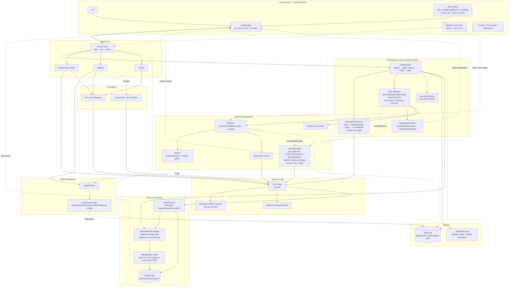
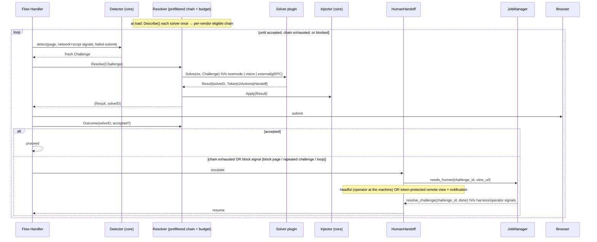

# ARCHITECTURE

> **v1 — get authenticated and hand the session back.** The agent signs up or logs in to a web
> app with **operator-provided credentials**, handles verification/2FA and CAPTCHAs (escalating
> to a human when fully blocked), then returns a **reusable session bundle** and an **auth-flow
> recording** so the calling agent can replay exactly how auth works. Model-agnostic, Go,
> deterministic-first. Exposed as a **CLI and a job-based MCP server**.
>
> **No scope enforcement of any kind** — the agent goes wherever the auth flow leads (including
> IdP/magic-link hosts). Everything is still audited.
>
> **Out of v1** (designed in §9, built later): authenticated crawling, an Explorer, task mode,
> and the account-safety deny-list.

---

## 1. Architecture choice (recap)

Hybrid, **deterministic-first** (ADR 0004): a code-first skill layer resolves known patterns
(form fields, multi-step transitions, cookie banners); the **LLM is invoked only for judgment**
(which flow variant this is, is this an error, did login succeed). Perception is
**accessibility-tree-first** with **screenshot + set-of-marks** as a vision escalation. This is
cheapest, most local-model-friendly, and most auditable — and v1's surface (drive an auth flow
to completion) is exactly where deterministic skills pay off.

---

## 2. System overview



**Reading the diagram.** A call (`start_auth`) becomes a **job**; the **JobManager** holds its
state and a **per-account lock**. The **Authenticator** first uses **Entrypoint Discovery** to
reach the login/signup form, then owns login/signup, drives verification (via
`VerificationProvider`) and CAPTCHA (via the `Resolver` chain), and escalates to **human
handoff** at any dead end. Throughout, the **AuthRecorder** captures every request/response
(CDP); on success the **SessionBundle builder** assembles cookies, storage, observed auth
headers, UA, proxy and token expiry, and the **Replayability Check** tests the bundle outside
the browser. Artefacts are written to the per-account workspace and the job finishes
`done{bundle_ref, recording_ref, trace}` (file paths / MCP resource URIs, not inline payloads).
**There is no ScopeGuard** — navigation is unrestricted (audited, not gated).

---

## 3. v1 data flow

`start_auth(target, account, mode, login_url?, signup_url?) → job → Authenticator:`
1. **Restore** a saved healthy session → done (no login).
2. **Entrypoint discovery** (§6.0): use `login_url`/`signup_url` hints if given, else the
   cached entrypoint for this target, else discover it from the root.
3. **mode=login** → run the login flow with provided creds. **mode=signup** → run the signup
   sequence: signup with provided email+password + profile fields (operator profile, else
   generated) → **verify** (link/code) → **log in if not yet authenticated**. If the app says
   the account already exists → **switch to login**. If the app offers **SSO only** →
   `failed{reason: sso_only}`.
4. During the flow: **verification** (page asks for a code/link → `VerificationProvider`; over
   MCP the job goes `needs_verification` and resumes on `resolve_challenge`); **CAPTCHA**
   (Detector → Resolver chain → Injector; fresh challenge per retry); **form-error recovery**
   (validation → fix & resubmit).
5. **Any dead end** (CAPTCHA chain exhausted, block page, challenge loop, unrecognised flow,
   stuck after N steps) → **human handoff** (job goes `needs_human{challenge_id, view_url}`;
   resumes on `resolve_challenge`).
6. **Success detection** (§6.3, deterministic) → **post-login capture** (§7.2) → assemble
   **SessionBundle** → **replayability check** (§7.4) → write artefacts → job
   `done{bundle_ref, recording_ref, trace}`.
Everything is redacted-then-audited; the AuthRecorder runs for the whole flow plus the bounded
post-login capture window.

---

## 4. Sequence — "start_auth" job (login or signup, with verification)

```mermaid
sequenceDiagram
  participant H as CLI/MCP caller
  participant J as JobManager
  participant A as Authenticator
  participant F as Flow Handler
  participant C as Credential store
  participant Ver as VerificationProvider
  participant Rec as AuthRecorder
  participant B as Browser

  H->>J: start_auth(target, account, mode, login_url?, signup_url?)
  J->>J: acquire per-account lock → job_id
  J-->>H: {job_id}
  J->>A: run(target, account, mode, hints)
  A->>Rec: begin recording (CDP network)
  A->>B: restore saved session?
  alt healthy saved session
    A->>B: ImportState + verify (§6.3)
    A-->>J: done (no login)
  else must authenticate
    A->>C: GetCredentials(account)  %% operator-provided
    C-->>A: email/username, password (+TOTP seed, +profile)
    A->>A: entrypoint discovery (§6.0): hint → cache → discover
    alt SSO-only app
      A-->>J: failed{reason: sso_only}
    end
    A->>A: mode=signup → signup sequence; mode=login → login flow
    A->>F: run(flow, creds, profile)
    F->>B: type/select/click (multi-step aware)
    opt CAPTCHA (see §5)
      F->>F: resolve via Resolver chain / human handoff
    end
    F->>B: submit
    opt signup hit "account exists"
      F->>A: switch to login flow
    end
    opt page needs a code/link
      A->>A: detect channel + hint
      A->>Ver: GetCode(Request{channel, account, hint, since, deadline})
      Note over J,Ver: over MCP: job → needs_verification{...}; harness → resolve_challenge(id, value)
      Ver-->>A: Code | Link | Approved
      A->>B: enter code / open link
    end
    alt submit form error
      F->>B: recover (fix field / regen) + resubmit
    end
    opt signup completed but not authenticated
      A->>F: run(login flow, creds)  %% signup → verify → login
    end
    opt dead end (unknown flow / stuck after N steps / block page)
      A->>J: needs_human{challenge_id, view_url}
      H->>J: resolve_challenge(challenge_id, done)
    end
    A->>A: success detection (§6.3)
  end
  A->>B: load landing page once
  A->>Rec: post-login capture (N requests or T seconds) → end recording
  A->>A: build SessionBundle → replayability check (§7.4)
  A->>J: write artefacts to workspace
  J->>J: release lock
  J-->>H: get_job → done{bundle_ref, recording_ref, trace}
```

## 5. Sequence — "CAPTCHA chain → human handoff on block"

Detector/Injector are core; solvers are plugins (gRPC) that only solve. The flow handler owns
submit; a fresh challenge is re-detected per retry (single-use tokens). When the chain is
exhausted or the agent is fully blocked, it escalates to a human.



---

## 6. Authentication subsystem

The `Authenticator` is the single owner of getting a session and keeping it long enough to hand
back. The JobManager calls it; everything below is internal.

### 6.0 Entrypoint discovery
Before any flow runs, the agent must reach the login or signup form. Resolution order:
1. **Operator hints** — `login_url` / `signup_url` passed to `start_auth`.
2. **Per-target cache** — an entrypoint discovered on a previous run (invalidated if it no
   longer yields a recognisable form).
3. **Discovery from the root**, deterministic first:
   - link/button text and a11y names: *sign in, log in, login, register, sign up, get started,
     create account, my account*;
   - common paths probed in order: `/login`, `/signin`, `/sign-in`, `/register`, `/signup`,
     `/sign-up`, `/auth`, `/account`, `/user/login`;
   - header/nav controls that open a **modal** login/signup;
   - a form is accepted as the entrypoint only when it matches a login/signup signature
     (password field, email/username field, submit control).
4. **Cheap LLM fallback** — given the a11y snapshot, pick the control most likely to start
   login/signup.
The resolved entrypoint (URL + how it was reached, e.g. "modal via header button") is cached
per target and reported in the trace.

### 6.1 Flow variants
single-page form · multi-step (email → password) · modal/iframe · magic-link · email/SMS OTP ·
TOTP MFA. Each has a handler, selected deterministically where possible (cheap LLM
classification only when ambiguous). The handler **owns the form submit** (hence owns CAPTCHA
submit + `Resolver.Outcome`) and **owns form-error recovery** (validation → fix & resubmit;
signup "account exists" → switch to login; give up after N).

**Signup sequence:** signup → verify (link/code via `VerificationProvider`) → **log in if the
app did not authenticate us after verification** → success detection (§6.3).

**OAuth/SSO is not a v1 flow.** If native login exists alongside SSO buttons, native is used.
If the app offers **SSO only**, the job fails fast with `failed{reason: sso_only}` rather than
looping.

### 6.2 Credentials & profile
**Email/username + password are operator-provided; never generated.** For signup forms that ask
for *incidental* fields (name, company, address, DOB), values come from an **optional operator
profile**, else the agent **generates sensible values** (config flag). TOTP seed and phone are
operator-supplied when relevant. The credential store holds these (encrypted) per account; each
account uses its **own persistent browser profile** (a returning-user profile reduces CAPTCHAs).

### 6.3 Auth success detection (deterministic)
Success holds when **any** strong signal does, cheapest first: (1) a new auth cookie or
bearer/JWT appeared in cookies/localStorage/sessionStorage; (2) a `/me`-style request returns
200; (3) an authenticated-only element (logout control, account menu) is present; (4) the login
form is gone and the URL left the auth route. LLM judgment is only a tiebreaker.

### 6.4 Session restore
At job start, a saved **healthy** session is imported into the account's context and verified via
§6.3 — if good, the job finishes without running any login flow. JWT `exp` is parsed and the
session's storage-location map recorded for the bundle.

### 6.5 Verification (pluggable, sync or async)
The agent detects the **channel** (email/SMS/TOTP/push) and a **hint** ("code sent to ***1234"),
then calls `VerificationProvider.GetCode(Request{channel, account, hint, since, deadline})` →
**`Code | Link | Approved`**; `Resend` re-triggers delivery and `since` ignores stale codes.
Implementations: **built-in TOTP** (instant from a seed), **CLI prompt** (blocking), **webhook**,
**tool/MCP** (async: job → `needs_verification{challenge_id, channel, hint, expires_at}`, harness
→ `resolve_challenge(challenge_id, value)`). The agent asks; the operator's tool answers.

### 6.6 CAPTCHA + human handoff
Core `Detector`/`Injector` per vendor; a `Resolver` runs a **`Describe()`-prefiltered** chain of
solver plugins (in-process `testmode`/`vision`, external over gRPC) within Budget; the flow
handler submits and calls `Resolver.Outcome`; a **fresh challenge is re-detected per retry**
(single-use tokens). When the **chain is exhausted or the agent is fully blocked** (repeated
challenges, a block/denied page, a challenge loop), it escalates to **`HumanHandoff`**: run
**headful** so the operator acts directly, or expose a **remote DevTools / screencast** view and
**notify**; over MCP the job returns **`needs_human{challenge_id, view_url}`** and resumes when
the harness/human calls `resolve_challenge(challenge_id, done)`. (ADR 0008/0011.)

**Human handoff covers any dead end, not only CAPTCHA:** an unrecognised flow, the agent
stuck after N steps without progress, or an unexpected block/denied page all escalate the same
way. The trace records why handoff was triggered.

**Protecting the remote view.** A remote DevTools session gives full control of an
authenticated browser. `view_url` is **bound to localhost by default**; when exposed beyond the
host it requires a **one-time token** embedded in the URL that expires when the challenge is
resolved or the job ends.

**Implemented chain (see `docs/CAPTCHA.md`).** Detection judges challenges by *computed
visibility* (not script presence), extracts vendor params, and fires from DOM, script signals and
failed-submit bodies. The default solver chain is **`testmode → native → vision → external →
human`** (configurable via `AGENTBROWSER_CAPTCHA_CONFIG`; human is always last): vendor test keys,
real-browser completion, a vision model for image/text, an out-of-process generic service adapter
(`plugins/captcha-generic/`), then handoff. Score/invisible challenges (reCAPTCHA v3, invisible v2,
managed/invisible Turnstile) are **non-blocking**. Per-`(target,vendor,solver)` stats drive optional
adaptive ordering; `agentbrowser eval --captcha` benchmarks the chain against mock vendor apps.

---

## 7. Session handback (the v1 product)

On success the job writes two artefacts to the per-account workspace and returns **references**
to them (file paths for the CLI, MCP resource URIs for MCP) plus a status/trace. Recordings get
large and contain secrets, so they are never returned inline in a job response.

### 7.1 SessionBundle
Everything a caller needs to replay the authenticated session:
- **Cookies** with domain/path/flags (Secure/HttpOnly/SameSite).
- **localStorage** and **sessionStorage** snapshots.
- **Auth headers observed on post-login XHR/fetch** — `Authorization`/bearer, CSRF tokens, custom
  headers — captured from traffic (they often live only in JS memory).
- **User agent** used, and the **proxy** used (if any).
- **Token expiry** where parseable (JWT `exp`).
- **`replayable: true|false`** plus a reason when false (see §7.4).
### 7.2 AuthRecorder (auth-flow recording)
A **HAR-style JSON** of every request/response during the signup/login flow **plus a bounded
post-login capture window**, so the caller can see and replay exactly how auth works.

**Post-login capture window:** after success detection the agent loads the app's landing page
once (the URL the app redirected to after login, else the root) and keeps recording until
**N authenticated requests** have been observed or **T seconds** have passed, whichever comes
first (defaults configurable, e.g. N=20, T=10s). Loading a page guarantees there is something
to capture even when login itself produced no follow-up XHRs.
**Bodies are included**; **secrets are flagged** (password fields, tokens, OTPs marked so the
caller can handle them carefully). This is a deliberate, scoped capture of the *auth flow only* —
not a general traffic/discovery engine.

### 7.3 Status + trace
Entrypoint used and how it was found, flow variant used, the verification/CAPTCHA steps taken,
whether and why human handoff was needed, the replayability result, and timings.

### 7.4 Replayability check
The calling agent wants to reuse the authenticated XHR flow, but some apps tie a session to the
browser itself. Before returning, the agent picks one captured authenticated XHR (a `GET`
preferred, e.g. the `/me`-style request from §6.3) and **replays it with a plain Go HTTP
client** using only the bundle's cookies and headers.
- Same status and a response body equivalent to the browser's → `replayable: true`.
- Otherwise → `replayable: false` with a reason, e.g. TLS/client fingerprinting, request
  signing, DPoP / proof-of-possession tokens, per-request headers computed by JavaScript, or
  session bound to IP/proxy.
This tells the caller whether it can use plain HTTP with the bundle or must keep driving the
session through a browser.

> **Sensitivity.** The bundle and recording contain live credentials/tokens. They are returned
> only to the authenticated caller, **redacted in the audit log**, and never persisted in clear
> beyond the per-account workspace (ADR 0016).

---

## 8. Interface (CLI + job-based MCP)

Because verification, CAPTCHA and human handoff can take minutes, the control surface is
**job-based**, over one core, with a **per-account lock** (one operation per account at a time):

- **`start_auth(target, account, mode=login|signup, login_url?, signup_url?)` → `{job_id}`**
- **`get_job(job_id)` → `status | needs_verification{challenge_id, channel, hint, expires_at} |
  needs_human{challenge_id, view_url, reason} | done{bundle_ref, recording_ref, trace} |
  failed{reason}`** (reasons include `sso_only`, `budget_exhausted`, `cancelled`,
  `handoff_timeout`)
- **`resolve_challenge(challenge_id, value)`** — one call for both pending states: a code, link
  or approval answers `needs_verification`; `done` answers `needs_human`.
- **`cancel_job(job_id)`**
- **`export_session(account)`** — return a reference to the latest SessionBundle for an account
  for reuse elsewhere.
The **CLI** answers verification/human handoff via an **interactive prompt**; the **MCP** surface
is async (poll `get_job`, answer pending challenges). Budgets, audit, and the per-account lock
apply identically to both. An **optional upstream proxy** is a browser-launch setting.

---

## 9. Phase 2 — authenticated crawl (design now, build later)

Starting from a **SessionBundle**, a later phase crawls the authenticated app:
- **Explorer**: navigate, open items, fill and submit forms, paginate — normal-user usage.
- **State dedup**: `simhash(structural a11y signature + path_template)`, collapsing parameterised
  routes (`/item/1`, `/item/2`) so it doesn't loop on lists.
- **Stop condition**: budget, or no new states for N iterations.
- **Mid-crawl session loss** → re-login (Authenticator) → **restart the in-flight sub-goal**.
- **Account-safety deny-list returns here** — enforced at an action-execution boundary so the
  crawl can't log itself out or damage the account: **logout, delete account, change password/
  email, revoke sessions/API keys**. (This is the *only* guardrail Phase 2 adds; still no scope
  allowlist.)
Phase 2 reuses v1's perception, model abstraction, skills, budgets and audit unchanged. (ADR 0013.)

---

## 10. Module boundaries (Go packages)

```
cmd/agentbrowser/       # CLI entrypoint
internal/
  server/               # MCP server + JobManager (start_auth/get_job/resolve_challenge/…)
  core/                 # typed action space, budget/kill-switch, (planner/verifier seams)
  perceive/             # a11y perceiver, set-of-marks
  browser/              # go-rod driver, persistent contexts, waiting, optional proxy
  model/                # LLMProvider interface, router, capability negotiation
    provider/           #   anthropic, openai, gemini, ollama, openaicompat
  auth/                 # Authenticator, flow handlers, success detection, session restore
    entry/              #   entrypoint discovery (hints, cache, link/path/modal probe, LLM fallback)
  verify/               # VerificationProvider (cli, tool/mcp, webhook, totp)
  captcha/              # core Detector/Injector/Resolver + HumanHandoff
    solver/             #   in-process: testmode, vision
    plugin/             #   go-plugin/gRPC host + proto + mock solver + conformance suite
  handback/             # AuthRecorder (HAR-style, post-login window), SessionBundle builder,
                        #   replayability check, artefact writer (paths / MCP resource URIs)
  identity/             # credential store (operator creds + profile, encrypted)
  audit/                # append-only log; redaction applied BEFORE write
  config/               # config load, per-account workspace
  eval/                 # benchmark harness, metrics, per-model comparison
  explore/              # Phase 2: Explorer + account-safety deny-list (design in §9)
```

**Dependency rule:** `core` depends on interfaces only. `audit` depends on nothing in the
project. **Auth is the single owner of authentication, verification, CAPTCHA and human handoff.**
There is **no ScopeGuard/PolicyEngine** in v1.

---

## 11. Key cross-cutting invariants (v1)

1. **No scope enforcement.** The agent navigates wherever the auth flow leads (incl. IdP/magic-
   link hosts). Navigation is audited, never gated.
2. **Credentials are operator-provided, never generated** — only incidental signup profile fields
   may be generated.
3. **CAPTCHA: core owns browser contact, solvers only solve, the flow handler owns submit** —
   `Describe()` once at load → prefiltered chain; fresh challenge re-detected per retry; chain
   exhaustion / block → human handoff.
4. **Redaction before every audit write** — the flow carries live credentials/tokens; entries are
   redacted at write time. The SessionBundle/recording are never audited in clear.
5. **Budgets cover tokens and solver cost/count** — checked at loop top, before every LLM call,
   and within the solver chain; kill-switch is a clean context cancellation.
6. **Per-account lock** — one operation drives an account's context at a time.
7. **Deterministic-first:** a skill is tried before any planner LLM call for the same step.
8. **Artefacts by reference** — bundles and recordings are written to the per-account
   workspace and returned as paths / MCP resource URIs, never inline in job responses.
9. **Every dead end has an exit** — the agent either succeeds, fails with a named reason, or
   hands off to a human; it never loops silently. The remote handoff view is localhost-bound
   or one-time-token protected.
