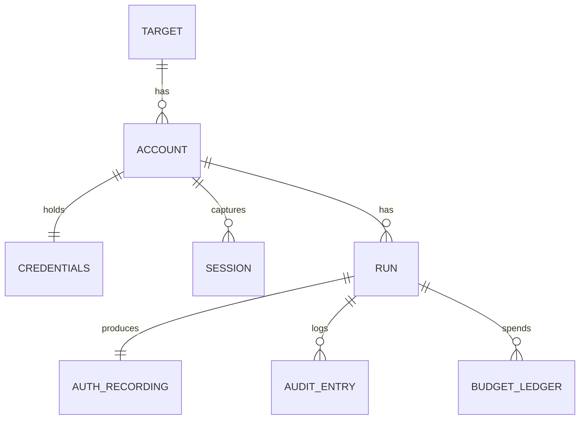

# DATA MODEL

> Storage: **SQLite per account workspace** (ADR 0006). One DB file per account keeps runs
> isolated, portable and easy to delete. IDs are ULIDs (sortable, no coordination). Timestamps
> are UTC epoch-ms. **No scope table, no endpoint inventory, no coverage model** — v1 authenticates
> and hands the session back.

The persisted entities are small: targets/accounts and their operator-provided credentials,
captured sessions, the handback artefacts (auth recording), auth **jobs/runs**, the hash-chained
audit log, and the budget ledger. (The state graph is **Phase 2** only — dedup/resumability for
the authenticated crawl.)

---

## 1. Entity overview

---

## 2. Target & account

### target
| col | type | notes |
|---|---|---|
| id | ULID PK | |
| name | text | app name |
| root_urls | json | entry URLs |
| created_at | int | |

> **No scope table.** v1 has no scope enforcement (ADR 0012) — the agent navigates wherever the
> auth flow leads (incl. IdP/magic-link/CAPTCHA-vendor hosts); navigation is audited, not gated.

### entrypoint_cache  (per target — ARCHITECTURE §6.0)
| col | type | notes |
|---|---|---|
| target_id | ULID FK | |
| mode | text | login \| signup |
| url | text | where the form was found |
| how | text | hint \| cache \| link \| path \| modal \| llm — how it was reached (e.g. "modal via header button") |
| found_at | int | |
| valid | int | invalidated when it no longer yields a recognisable login/signup form |

### account  (one per role/identity the operator provides)
| col | type | notes |
|---|---|---|
| id | ULID PK | the `AccountID` used across the system |
| target_id | ULID FK | |
| label | text | operator's name for it (e.g. `alice`, `admin`) |
| role | text | optional role tag (user/admin/…); informational |
| created_at | int | |

Each account runs in its **own browser context** (isolated cookies/storage).

### credentials  (operator-provided; never generated)
| col | type | notes |
|---|---|---|
| account_id | ULID FK | |
| username_or_email | text | |
| secret_ref | text | pointer into the encrypted secret store (password never in a cleartext column) |
| totp_seed_ref | text | nullable; encrypted-store pointer to a TOTP seed the operator supplied (built-in TOTP generator uses it) |
| phone | text | nullable; for SMS-OTP routing by the VerificationProvider |
| profile | json | nullable; **optional operator-supplied incidental signup fields** (name, company, address, DOB…). When absent, the signup flow **generates** sensible values (config flag). Credentials themselves are never generated |

Everything sensitive (`secret_ref`, `totp_seed_ref`) is encrypted at rest; key from OS keyring
or operator passphrase. The `profile` holds only incidental, non-secret form values.

---

## 3. Session (captured, reusable, exportable)

### session
| col | type | notes |
|---|---|---|
| id | ULID PK | |
| account_id | ULID FK | |
| cookies | blob | encrypted |
| local_storage | blob | encrypted |
| session_storage | blob | encrypted |
| tokens | blob | encrypted (bearer/refresh observed in storage) |
| auth_headers | blob | encrypted; **auth headers observed in traffic** (e.g. `Authorization`/bearer held only in JS memory and sent on XHR) — needed to replay bearer-only sessions |
| user_agent | text | the UA used, so a consumer can match it on replay |
| proxy_binding | text | nullable; note on IP/proxy binding (e.g. "ip-bound via <proxy>") warning that the token may not reuse off that egress |
| replayable | int | result of the replayability check (§7.4): a plain-HTTP replay of one authed XHR matched the browser |
| replay_reason | text | nullable; when not replayable: tls_fingerprint \| request_signing \| dpop \| js_computed_headers \| ip_bound \| … |
| storage_map | json | where each credential lives (cookie vs localStorage vs sessionStorage) |
| jwt_exp | int | nullable; parsed JWT expiry for lifecycle management |
| captured_at | int | |
| healthy | int | last health-check result |

The `session` row **is** the SessionBundle (ADR 0016): `export_session(account)` returns cookies +
local/session storage + tokens + **observed auth headers + user-agent + proxy/IP-binding note**, so
a session (incl. bearer-only or IP-bound) can be reused elsewhere. Observing auth headers is a
narrow session-capture hook, not a discovery engine.

### auth_recording  (the other handback artefact — ADR 0016)
| col | type | notes |
|---|---|---|
| id | ULID PK | |
| run_id | ULID FK | |
| format | text | "har-1.2-json" |
| entries_ref | text | path to the HAR-style JSON (auth flow + first few authenticated XHRs; bodies included) |
| secret_map | json | which fields/headers/bodies are flagged secret (password, token, OTP) for careful handling |
| created_at | int | |

---

## 4. Job / run & budget

### run  (one per `start_auth` job)
| col | type | notes |
|---|---|---|
| id | ULID PK | the `job_id` |
| target_id | ULID FK | |
| account_id | ULID FK | |
| mode | text | login \| signup |
| entry | text | cli \| mcp |
| state | text | running \| needs_verification \| needs_human \| done \| failed \| cancelled |
| hints | json | nullable; operator `login_url` / `signup_url` entrypoint hints |
| pending | json | nullable; the current pending challenge {challenge_id, kind, channel, hint, view_url, reason, expires_at} — `view_url` is localhost-bound or carries a one-time token |
| reason | text | nullable; named failure reason: sso_only \| budget_exhausted \| cancelled \| handoff_timeout \| verification_timeout \| flow_failed |
| bundle_ref | text | nullable; path / MCP resource URI of the written SessionBundle (on done) |
| recording_ref | text | nullable; path / MCP resource URI of the written AuthRecording (on done) |
| trace | json | nullable; entrypoint + how found, flow variant, verification/CAPTCHA/handoff steps (+reason), replayability, timings |
| started_at / ended_at | int | |
| config_hash | text | reproducibility (prompts+models+flags) |

> The **per-account lock** is runtime state in the JobManager, not a table; at most one non-terminal
> `run` exists per account at a time.

### budget_ledger  (append-only; sums enforce limits)
| col | type | notes |
|---|---|---|
| id | ULID PK | |
| run_id | ULID FK | |
| kind | text | time \| requests \| tokens \| cost_usd \| solver_cost_usd \| solves |
| amount | real | delta |
| at | int | |

---

## 5. Audit log (append-only, hash-chained)

### audit_entry
| col | type | notes |
|---|---|---|
| id | ULID PK | |
| run_id | ULID FK | |
| seq | int | per-run sequence |
| at | int | UTC ms |
| actor | text | loop \| skill:<name> \| planner \| authenticator \| flow:<variant> \| captcha \| verify \| human_handoff |
| kind | text | action \| navigate \| request \| llm_call \| captcha \| verification \| human_handoff \| session \| error |
| payload | json | typed per kind, **redacted before write** (SessionBundle/AuthRecording never stored here in clear) |
| prev_hash | text | sha256 of previous entry |
| hash | text | sha256(prev_hash + canonical(payload)) — tamper-evidence |

**Invariants:** an append is durable before the described action runs; a failed append trips
the kill-switch. `payload` is **redacted before persistence** (prompts and captured data carry
the operator's app data) — there is no un-redacted stored copy. The hash chain is verified on
load; a break marks the run `integrity_suspect`.

---

## 6. State graph (Phase 2 only — dedup + resumability)

> **Not used in v1.** This exists for the Phase-2 authenticated crawl (ADR 0013), so the Explorer
> doesn't loop and a killed crawl can resume — **not** an inventory. Listed here so the schema is
> designed once.

### state_node
| col | type | notes |
|---|---|---|
| id | ULID PK | |
| run_id | ULID FK | |
| url_template | text | normalised URL (query stripped, ids templated) |
| state_hash | text | `simhash(structural a11y signature + path_template)` |
| title | text | |
| perception | json | compact a11y snapshot cache |
| first_seen_at | int | |
| visit_count | int | |

### state_edge
| col | type | notes |
|---|---|---|
| id | ULID PK | |
| run_id | ULID FK | |
| from_node | ULID FK | |
| to_node | ULID FK | |
| action | json | the typed Action that caused the transition |
| at | int | |

**State hashing.** `state_hash = simhash(structural_signature)` over interactive-node
roles+labels + landmark structure + path template (query values stripped, ids templated). Two
states within a Hamming threshold are "the same view" → dedup; parameterised routes
(`/item/1`, `/item/2`) collapse to `/item/{id}` so the Explorer doesn't loop on lists. The
threshold is config; **a spike tunes it** against apps with known state counts (RISKS).

**Resumability (Phase 2).** A crawl checkpoint `{current_node, visited_hashes, in_flight_subgoal}`
lets a killed crawl reload, re-import the session, re-perceive and continue; a mid-crawl session
loss re-logs-in (Authenticator) and restarts the in-flight sub-goal. (v1 auth jobs are short and
resumed only via the pending-challenge mechanism, not a state checkpoint.)

---

## 7. Indexing & integrity notes

- Unique index `(run_id, state_hash)` on `state_node` — dedup lookups are hot.
- Index `(account_id, captured_at)` on `session` — latest-session lookup.
- `audit_entry.hash` chain verified on load.
- Session blobs are encrypted at the app layer before insert; the DB file may optionally sit on
  an encrypted volume / SQLCipher (config option).
